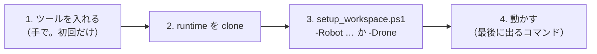
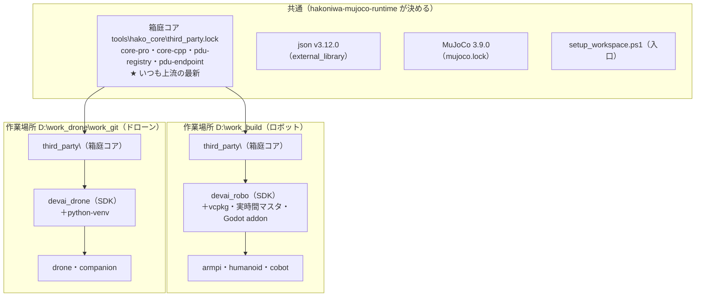

# ここから読む — 新しい Windows PC でロボット・ドローンを建てる

armpi・humanoid・cobot（ロボット）と hakoniwa-mujoco-drone・companion（ドローン）を、**新しい Windows 11 の PC** に建てるときの入口です。
手順は 1 本のスクリプト **`tools\windows\setup_workspace.ps1`** にまとめてあります。この文書のとおりに進めれば、ほかの文書を探す必要はありません
（細かいことを知りたいときだけ、§6 の表の文書を開きます）。



## 1. ツール（手で入れる。初回だけ）

| ツール | 版 | メモ |
|---|---|---|
| Windows 11 | 64 bit | |
| Visual Studio 2022 | Community・Professional・Enterprise・Build Tools のどれか | 「**C++ によるデスクトップ開発**」を入れる（場所はスクリプトが vswhere で探す） |
| CMake | 3.21 以上 | PATH に置く |
| Git | 2.x | PATH に置く。`git config --global core.longpaths true` |
| Python | **3.12（64 ビット）** | python.org 版を既定の場所（`%LOCALAPPDATA%\Programs\Python\Python312`）に |
| Godot | **4.7.1 mono** | ビューア・ライブで使う。既定 `D:\Godot_v4.7.1-stable_mono_win64\`（別の場所なら `-Godot <exe>`） |
| ディスク | ロボット 約 5 GB・ドローン 約 3 GB | |

- **作業場所は浅いところ**に（例 `D:\work_build`）。長いパスで失敗することがあります。
- **ロボットとドローンは別の作業場所**に建てます（例 ロボット `D:\work_build`、ドローン `D:\work_drone\work_git`）。理由は §5。
- プロキシの内側なら `HTTP_PROXY`・`HTTPS_PROXY` を先に設定します（展示会の PC＝テザリングでは要りません）。

## 2. runtime を clone する

```powershell
mkdir D:\work_build; cd D:\work_build
git clone https://github.com/hako-community/hakoniwa-mujoco-runtime.git
```

## 3. 1 本で建てる

```powershell
cd D:\work_build
# ロボット（1 つでも、いくつでも）
powershell -ExecutionPolicy Bypass -File hakoniwa-mujoco-runtime\tools\windows\setup_workspace.ps1 -Robot humanoid
powershell -ExecutionPolicy Bypass -File hakoniwa-mujoco-runtime\tools\windows\setup_workspace.ps1 -Robot humanoid,cobot,armpi

# ドローン（別の作業場所で。runtime もそこに clone する）
cd D:\work_drone\work_git
powershell -ExecutionPolicy Bypass -File hakoniwa-mujoco-runtime\tools\windows\setup_workspace.ps1 -Drone -Test
```

スクリプトがすること（できているものは飛ばすので、何度流してもよい。止まったら直して `-From <番号>` で再開）:

| 段 | 内容 | ロボット | ドローン | 時間 |
|---|---|---|---|---|
| W1 | ツールの確認 | ✓ | ✓ | 数秒 |
| W2 | 足りないリポジトリを clone | humanoid は hakoniwa-armpi・hakoniwa-godot-robot（**非公開**。権限が要る）も | drone・companion | 1 分 |
| W3 | 各リポジトリの `deps.lock` の版で runtime・sensor を確かめる（`tools\fetch_deps.py`） | ✓ | ✓ | 数秒 |
| W4 | **箱庭コア**を `<作業場所>\third_party` に取る（`tools\hako_core\fetch_third_party.py`。§5） | ✓ | ✓ | 1 分 |
| W5 | SDK を作る | `devai_robo`（`robo_sdk\setup_robo_sdk.ps1`） | `devai_drone`（drone の `tools\local_sdk\setup_windows.ps1`） | ロボット 約 1〜1.5 時間・ドローン 約 10 分 |
| W6 | ロボットごとの準備 | humanoid: 設定 `config.local.ps1` を作り、Python・venv・Godot addon／cobot・armpi: venv・ビルド・addon | — | 各 数分 |
| W7 | 確認と「次に動かすコマンド」 | SDK の確認（箱庭コアの版も）・humanoid の環境確認 | `-Test` で ctest（約 25 分） | |

| オプション | 意味 |
|---|---|
| `-Check` | 何も作らず確かめるだけ（W1・W3・W4・W7） |
| `-From N` | W-N から再開 |
| `-RebuildSdk` | SDK の箱庭コアが lock と違うとき、今の SDK を `devai_robo.old-<日時>` に退避して作り直す（箱庭コアがもう lock と同じ作りかけなら、退避せずに続きを作る） |
| `-SdkFrom N` | 上の「続き」を setup_robo_sdk の S-N から（例 `-From 5 -SdkFrom 5`） |
| `-Robo <場所>` | ロボット共通 SDK の場所（既定 `<作業場所>\devai_robo`） |
| `-Godot <exe>` | Godot 4.7.1 の exe |
| `-WithNcMachine` | cobot を加工機と連携する形で（hakoniwa-ncmachine も clone） |
| `-Test` | ドローンの ctest も流す |

## 4. 動かす

最後に表示されるコマンドを使います。

| 対象 | 動かす | 何が見えればよいか |
|---|---|---|
| humanoid（展示会の箱庭版ライブ） | `hakoniwa-humanoid\scripts\windows\factory_demo\hako\start_hako.bat` | Godot に工場。A/B/C を切り替え・攻撃開始ができる。手順書 06 |
| humanoid（Godot なしの確認） | `…\factory_demo\hako\check_hako.ps1 -Scenario rezot` | 4/4 台が搬送を続け、実時間比 約 1.0 |
| cobot | `hakoniwa-cobot\scripts\windows\verify_all.ps1` | 全部 合格 |
| armpi | `hakoniwa-armpi\scripts\windows\run_demo.ps1 -Demo motion` | Godot に ArmPi が振付どおりに動く。`logs\win_*\run.json` |
| drone | `hakoniwa-mujoco-drone\tools\local_sdk\setup_windows.ps1 run` | Origin-01 ×2 機が飛ぶ |

## 5. ロボットとドローンで共通のもの・別のもの



| | ロボット | ドローン |
|---|---|---|
| 箱庭コア | **同じ**（runtime の `tools\hako_core\third_party.lock`。上流の最新） | **同じ** |
| json・MuJoCo・Python 3.12・hakoniwa-pdu 1.6.9・VS 2022（vswhere）・Godot 4.7.1 | 同じ | 同じ |
| 依存の版の決め方 | 各リポジトリの `deps.lock`（runtime・sensor）＋ `tools\fetch_deps.py` | 同じ（companion は drone も） |
| SDK | `devai_robo`（PowerShell の `robo_sdk`。vcpkg の Boost・実時間マスタ・Godot の GDExtension を含む） | `devai_drone`（Git Bash の `local_sdk`。Python の venv を含む） |
| 共有メモリの既定 | `Z:/mmap_robo`、無ければ `C:/hako_mmap_robo` | `Z:/mmap`、無ければ `C:/hako_mmap_drone` |

- 作業場所を分けるのは、SDK の中身（ロボットは Boost・GDExtension、ドローンは venv）と既定の共有メモリが違うため。箱庭コアの版は同じです。
- ★ `third_party\` の下は他者のリポジトリです。編集・ビルド・checkout はしません（スクリプトは clone と照合だけ。SDK は `git archive` で外に写してから作る）。
- 箱庭コアを最新に上げる手順は **[hako_core_update.md](hako_core_update.md)**。

## 6. もっと詳しく（必要なときだけ）

| 知りたいこと | 文書 |
|---|---|
| ロボット共通 SDK の中身・段（S0〜S5）・困ったとき | [windows_robot_setup.md](windows_robot_setup.md) |
| 箱庭コアを上流の最新に上げる | [hako_core_update.md](hako_core_update.md) |
| humanoid 工場デモ（構成・動画版・UDP 版・箱庭版の操作・困ったとき） | `hakoniwa-humanoid\docs\windows_factory_demo\README.md` |
| cobot（セル・ビューア・検証） | `hakoniwa-cobot\docs\windows_setup.md` |
| armpi（デモの種類・オプション） | `hakoniwa-armpi\docs\windows_setup.md` |
| ドローン（SDK・ビルド・試験・Linux・hakodrone の配布） | `hakoniwa-mujoco-drone\tools\local_sdk\README.md` |

## 7. 困ったとき

| 症状 | 対処 |
|---|---|
| W1 で `[NG]` | §1 のツールを入れる |
| W2 で hakoniwa-godot-robot の clone が失敗 | 非公開。hako-community の権限のあるアカウントで `gh auth login` してから `-From 2` |
| W3 で `deps.lock と違う` | runtime を clone したあとに runtime だけ新しくなった。`git -C hakoniwa-mujoco-runtime checkout <deps.lock のコミット>` か、ロボットの deps.lock が上がるのを待つ |
| W4 で `third_party の版が lock と違う` | `python hakoniwa-mujoco-runtime\tools\hako_core\fetch_third_party.py --refresh`（今のものは退避。中身は触らない） |
| W5 で `SDK が lock と違う` | `-RebuildSdk`（今の SDK は退避）。ロボットの SDK を作り直したら W6 もやり直す（スクリプトが続けて行う） |
| W5 で `退避が途中です` | SDK のフォルダごとの名前の変更が拒否され（**作業場所を VS Code で開いている**と、そのファイル監視で必ず拒否される。ほかに Godot・エクスプローラー・ウイルス対策など）、中身を 1 つずつ移している途中で、使用中のファイルで止まった。止めたものを閉じて同じコマンドをもう一度（退避先の `_MOVE_INCOMPLETE.txt` を見て続きを移す） |
| W5 の途中（S1〜S5 のどこか）で止まった | 原因を直して `-From 5 -SdkFrom <止まった S の番号>`。SDK の箱庭コアがもう lock と同じなら、退避せずに続きから作る（`-RebuildSdk` を付けたままでよい） |
| `Filename too long` | `git config --global core.longpaths true`。作業場所を浅く |
