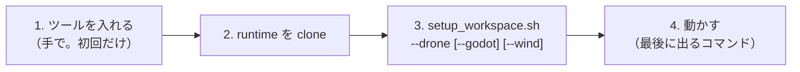

# ここから読む — 新しい Linux PC でドローンを建てる

hakoniwa-mujoco-drone・companion（ドローン）と、そのビューア（hakoniwa-godot-drone）・風況デモ（hakoniwa-simenv-4dst ＋ hakoniwa-godot-4dst）を、
**新しい Linux（Ubuntu 24.04・x86_64）の PC** に建てるときの入口です。Windows 版の [START_HERE.md](START_HERE.md) と同じ段（W1〜W7）を、
1 本のスクリプト **`tools/linux/setup_workspace.sh`** で行います。

> ロボット（armpi・humanoid・cobot）の Linux 版はまだありません（Windows の `setup_workspace.ps1 -Robot`）。



## 1. ツール（手で入れる。初回だけ）

| ツール | 版 | 入れ方・メモ |
|---|---|---|
| Ubuntu | 24.04（x86_64） | 22.04 は python3 が 3.10 なので不可（hakopy は 3.12 向け） |
| C++ のビルド一式 | gcc 13・CMake 3.21 以上・ninja | `sudo apt install build-essential cmake ninja-build git curl` |
| Python | **3.12**（Ubuntu 24.04 の python3）＋ venv | `sudo apt install python3-venv` |
| GitHub CLI | 2.x | `sudo apt install gh` → `gh auth login`（`--godot`・`--wind` で非公開の Release を取る） |
| git-lfs | 3.x | `--wind` のとき。`sudo apt install git-lfs` |
| Godot | **4.7.1 mono**（Linux x86_64） | `--godot`・`--wind` のとき。既定の場所 `/usr/local/bin/Godot_v4.7.1-stable_mono_linux_x86_64/`（別の場所なら `--godot <実行ファイル>` か `GODOT_BIN`） |
| .NET SDK | **8.0** | `--godot`・`--wind` のとき。`dotnet-install.sh --channel 8.0` で `~/.dotnet` に（別の場所なら `DOTNET_ROOT`） |
| ディスク | ドローン 約 3 GB・風況デモ ＋約 1.5 GB | |

- 旧 SDK（`/usr/local/hakoniwa`・`/etc/ld.so.conf.d/hakoniwa.conf`）が入っていても構いません。各スクリプトが**そのプロセスの中だけで**
  `PATH`・`LD_LIBRARY_PATH`・`PYTHONPATH` から外します（`.bashrc` などは触りません）。
- 共有メモリの既定は `/dev/shm/hakoniwa-$USER`（`MMAP_PATH` で変えられる）。

## 2. runtime を clone する

```bash
mkdir -p ~/work_drone/work_git && cd ~/work_drone/work_git
git clone https://github.com/hako-community/hakoniwa-mujoco-runtime.git
```

## 3. 1 本で建てる

```bash
cd ~/work_drone/work_git
bash hakoniwa-mujoco-runtime/tools/linux/setup_workspace.sh --drone                  # ドローンだけ（約 5 分）
bash hakoniwa-mujoco-runtime/tools/linux/setup_workspace.sh --drone --godot --wind   # ビューアと風況デモも
bash hakoniwa-mujoco-runtime/tools/linux/setup_workspace.sh --drone --test           # ctest も（約 25 分）
```

スクリプトがすること（できているものは飛ばすので、何度流してもよい。止まったら直して `--from <番号>` で再開）:

| 段 | 内容 | 時間 |
|---|---|---|
| W1 | ツールの確認 | 数秒 |
| W2 | 足りないリポジトリを clone（drone・companion。`--godot` は hakoniwa-godot-drone、`--wind` は hakoniwa-simenv-4dst・hakoniwa-godot-4dst と LFS の実体） | 1 分 |
| W3 | 各リポジトリの `deps.lock` の版で runtime・sensor を確かめる（`tools/fetch_deps.py`） | 数秒 |
| W4 | **箱庭コア**を `<作業場所>/third_party` に取る（`tools/hako_core/fetch_third_party.py`） | 1 分 |
| W5 | SDK とビルド: `devai_drone`（drone の `tools/local_sdk/setup_linux.bash`。箱庭コア・MuJoCo 3.9.0・venv・drone・companion・sensor_bridge） | 約 3〜5 分 |
| W6 | ビューア: `--godot` は hakoniwa-godot-drone の `tools/fetch_native.sh`（`libhakodrone.so`）と C# ビルド。`--wind` は 4DST の元データ（`fetch_envdata.sh`）・`devai_windpj/.venv`（netCDF4）・hakoniwa-godot-4dst の取り込みと C# ビルド | 数分（envdata は約 340 MB） |
| W7 | 確認と「次に動かすコマンド」: `--test` で ctest、`--wind` なら風況デモのヘッドレス確認も | |

| オプション | 意味 |
|---|---|
| `--check` | 何も作らず確かめるだけ（W1・W3・W4・W7） |
| `--from N` | W-N から再開 |
| `--rebuild-sdk` | `devai_drone` の SDK・MuJoCo・venv を作り直す（箱庭コアの lock が上がったとき） |
| `--godot [<exe>]` | hakoniwa-godot-drone も建てる（Godot の場所も渡せる） |
| `--wind` | 風況デモ（hakoniwa-simenv-4dst の `examples/wind_flight_demo`）も建てる |
| `--test` | ドローンの ctest も流す |
| `--workspace DIR` | 作業場所（既定: runtime の親） |

## 4. 動かす

| 対象 | 動かす | 何が見えればよいか |
|---|---|---|
| drone | `bash hakoniwa-mujoco-drone/tools/local_sdk/setup_linux.bash run` | Origin-01 ×2 機が飛ぶ（実時間比 約 15x・最終高度 5.2 m） |
| drone（試験） | `bash hakoniwa-mujoco-drone/tools/local_sdk/setup_linux.bash test` | drone 97 本・companion 32 本（Windows は hil_bridge が無い分 1 本少ない） |
| Godot（オフライン） | `cd hakoniwa-godot-drone && DOTNET_ROOT=$HOME/.dotnet $GODOT_BIN --path . res://Scenes/drone_1.tscn`（`DOTNET_ROOT` が無いと Godot mono は起動時に落ちる） | 内蔵 FC（`libhakodrone.so`）でゲームパッド・キーボード操縦 |
| Godot（箱庭経由） | `source hakoniwa-mujoco-drone/tools/local_sdk/env_linux.bash` のあとで同じ Godot を起動 | `HAKO_NATIVE_LIB_DIR` が SDK の `libshakoc.so` を指す（プラントと同じ箱庭コア） |
| 風況デモ | `bash hakoniwa-simenv-4dst/examples/wind_flight_demo/run_wind_flight_demo.sh [--wind \| --live \| --modes]` | 大甕の景観の上を origin01 が飛ぶ（README §2。Windows の `-Wind`・`-Live`・`-Modes` と同じ） |

## 5. Windows との違い

| | Windows | Linux |
|---|---|---|
| 入口 | `tools\windows\setup_workspace.ps1 -Drone` | `tools/linux/setup_workspace.sh --drone` |
| ドローンの SDK・ビルド | `setup_windows.ps1`（Git Bash ＋ VS 2022） | `setup_linux.bash`（gcc ＋ ninja） |
| SDK の置き場 | `devai_drone/sdk/windows-msvc-x64` | `devai_drone/sdk/linux-gcc-x64` |
| 共有メモリ | `Z:/mmap`、無ければ `C:/hako_mmap_drone` | `/dev/shm/hakoniwa-$USER` |
| hakodrone の配布物 | `hakodrone-windows-x86_64.zip`（`hakodrone.dll`） | `hakodrone-linux-x86_64.zip`（`libhakodrone.so`） |
| ctest | drone 96 本（`hil_bridge_app` を作らない） | drone 97 本 |

- 箱庭コアの版・json・MuJoCo・Python 3.12・hakoniwa-pdu 1.6.9・Godot 4.7.1 は**同じ**です。
- ★ 乱数の列（`std::normal_distribution`）は MSVC と libstdc++ で違うので、種 1 本の結果は OS で入れ替わることがあります
  （drone の `tools/local_sdk/README.md` 注意 4）。

## 6. 困ったとき

| 症状 | 対処 |
|---|---|
| W1 で `[NG]` | §1 のツールを入れる |
| W3 で `deps.lock と違う` | runtime を clone したあとに runtime だけ新しくなった。表示の「lock の版にする」のコマンドを流して `--from 3` |
| W4 で `third_party の版が lock と違う` | `python3 hakoniwa-mujoco-runtime/tools/hako_core/fetch_third_party.py --refresh`（今のものは退避） |
| W5 で `SDK の箱庭コアが lock と違う` | `--rebuild-sdk` |
| W6 の `fetch_native.sh` が `取得に失敗` | `gh auth login`（hako-community/releases-channel を読む権限が要る） |
| `$'\r': command not found` | bash の台本が CRLF になっている。`git config core.autocrlf false` で clone し直す（各リポジトリの `.gitattributes` で `*.sh`・`*.bash` は LF） |
| Godot が `libshakoc.so` を旧 SDK から読む | `env_linux.bash` を読んだシェルから起動する（`HAKO_NATIVE_LIB_DIR`）。同梱の `Plugins/Linux/x86_64/libshakoc.so` も SDK と同じ版 |
