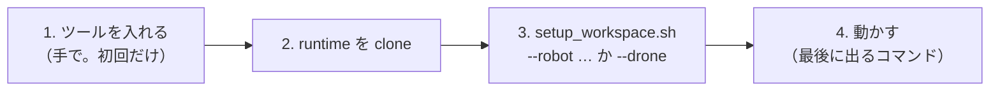

# ここから読む — 新しい Linux PC でロボット・ドローンを建てる

armpi・humanoid・cobot（ロボット。cobot は NC 加工機との連携も）と、hakoniwa-mujoco-drone・companion（ドローン）・そのビューア・風況デモを、
**新しい Linux（Ubuntu 24.04・x86_64）の PC** に建てるときの入口です。Windows 版の [START_HERE.md](START_HERE.md) と同じ段（W1〜W7）を、
1 本のスクリプト **`tools/linux/setup_workspace.sh`** で行います。



## 1. ツール（手で入れる。初回だけ）

| ツール | 版 | 入れ方・メモ | ロボット | ドローン |
|---|---|---|---|---|
| Ubuntu | 24.04（x86_64） | 22.04 は python3 が 3.10 なので不可（hakopy は 3.12 向け） | ✓ | ✓ |
| C++ のビルド一式 | gcc 13・CMake 3.21 以上・ninja | `sudo apt install build-essential cmake ninja-build git curl` | ✓ | ✓ |
| Python | **3.12**（Ubuntu 24.04 の python3）＋ venv・ヘッダ | `sudo apt install python3-venv python3-dev` | ✓ | ✓（ヘッダは不要） |
| vcpkg の初期化に要る道具 | | `sudo apt install zip unzip tar pkg-config` | ✓ | |
| GLFW・OpenGL | Ubuntu の 3.3.10 | `sudo apt install libglfw3-dev libgl-dev`（プラントの確認用の窓。Windows は vcpkg の 3.5.1） | ✓ | |
| GitHub CLI | 2.x | `sudo apt install gh` → `gh auth login`（非公開の hakoniwa-godot-robot・hakoniwa-ncmachine、ドローンの Release） | humanoid・加工機 | `--godot`・`--wind` |
| Godot | **4.7.1 mono**（Linux x86_64） | 既定の場所 `/usr/local/bin/Godot_v4.7.1-stable_mono_linux_x86_64/`（別の場所なら `--godot <実行ファイル>` か `GODOT_EXE`） | ビューア | `--godot`・`--wind` |
| .NET SDK | **8.0** | `dotnet-install.sh --channel 8.0` で `~/.dotnet` に（別の場所なら `DOTNET_ROOT`。無いと Godot mono は起動時に落ちる） | ビューア | `--godot`・`--wind` |
| Blender | 5.2 | 加工機のモデルの GLB（`--with-ncmachine`）。既定 `/usr/local/bin/blender-5.2*/blender`（`--blender <exe>` か `BLENDER_EXE`）。無ければ GLB なしで作る | 加工機 | |
| git-lfs | 3.x | `sudo apt install git-lfs` | | `--wind` |
| ディスク | | ロボット 約 6 GB・ドローン 約 3 GB・風況デモ ＋約 1.5 GB | | |

- **ロボットとドローンは別の作業場所**に建てます（例 ロボット `~/work_robot/work_git`、ドローン `~/work_drone/work_git`）。理由は §5。
- 旧 SDK（`/usr/local/hakoniwa`・`/etc/ld.so.conf.d/hakoniwa.conf`・`/usr/lib/x86_64-linux-gnu/libshakoc.so.1` など）が入っていても構いません。
  各スクリプトが**そのプロセスの中だけで** `PATH`・`LD_LIBRARY_PATH`・`PYTHONPATH` から外し、作るものは RUNPATH で SDK の中だけを見ます（`.bashrc` などは触りません）。
- 1 回でまとめて入れるなら:
  `sudo apt install build-essential cmake ninja-build git curl python3-venv python3-dev zip unzip tar pkg-config libglfw3-dev libgl-dev gh git-lfs`

## 2. runtime を clone する

```bash
mkdir -p ~/work_robot/work_git && cd ~/work_robot/work_git        # ドローンなら ~/work_drone/work_git
git clone https://github.com/hako-community/hakoniwa-mujoco-runtime.git
```

## 3. 1 本で建てる

```bash
cd ~/work_robot/work_git
# ロボット（1 つでも、いくつでも）
bash hakoniwa-mujoco-runtime/tools/linux/setup_workspace.sh --robot humanoid
bash hakoniwa-mujoco-runtime/tools/linux/setup_workspace.sh --robot humanoid,cobot,armpi
bash hakoniwa-mujoco-runtime/tools/linux/setup_workspace.sh --robot cobot --with-ncmachine     # cobot を NC 加工機と連携する形で（§4.2）

# ドローン（別の作業場所で。runtime もそこに clone する）
cd ~/work_drone/work_git
bash hakoniwa-mujoco-runtime/tools/linux/setup_workspace.sh --drone                  # ドローンだけ（約 5 分）
bash hakoniwa-mujoco-runtime/tools/linux/setup_workspace.sh --drone --godot --wind   # ビューアと風況デモも
bash hakoniwa-mujoco-runtime/tools/linux/setup_workspace.sh --drone --test           # ctest も（約 25 分）
```

スクリプトがすること（できているものは飛ばすので、何度流してもよい。止まったら直して `--from <番号>` で再開）:

| 段 | 内容 | ロボット | ドローン | 時間 |
|---|---|---|---|---|
| W1 | ツールの確認 | ✓（Godot・.NET・gh が無いときは注意だけ） | ✓ | 数秒 |
| W2 | 足りないリポジトリを clone | humanoid は hakoniwa-armpi・hakoniwa-godot-robot（**非公開**）も。`--with-ncmachine` は hakoniwa-ncmachine（**非公開**）・image2sim-framework も | drone・companion（`--godot`・`--wind` はビューア・4DST も） | 1 分 |
| W3 | 各リポジトリの `deps.lock` の版で runtime・sensor を確かめる（`tools/fetch_deps.py`） | ✓ | ✓ | 数秒 |
| W4 | **箱庭コア**を `<作業場所>/third_party` に取る（`tools/hako_core/fetch_third_party.py`。§5） | ✓ | ✓ | 1 分 |
| W5 | SDK を作る | `devai_robo`（`tools/linux/robo_sdk/setup_robo_sdk.bash`。§3.1） | `devai_drone`（drone の `tools/local_sdk/setup_linux.bash`） | ロボット 約 15〜40 分・ドローン 約 5 分 |
| W6 | ロボットごとの準備 | humanoid: venv・ArmPi のモデル・Godot addon／cobot・armpi: venv・ビルド（単体試験も）・addon | `--godot`・`--wind` のビューア | 各 数分 |
| W7 | 確認と「次に動かすコマンド」 | SDK の確認（箱庭コアの版も）・humanoid の環境確認 | `--test` で ctest（約 25 分） | |

| オプション | 意味 |
|---|---|
| `--check` | 何も作らず確かめるだけ（W1・W3・W4・W7） |
| `--from N` | W-N から再開 |
| `--rebuild-sdk` | ロボット: SDK の箱庭コアが lock と違うとき、今の SDK を `devai_robo.old-<日時>` に退避して作り直す（箱庭コアがもう lock と同じ作りかけなら、退避せずに続きを作る）。ドローン: SDK・MuJoCo・venv を作り直す |
| `--sdk-from N` | ロボット SDK の「続き」を setup_robo_sdk の S-N から（例 `--from 5 --sdk-from 5`） |
| `--robo <場所>` | ロボット共通 SDK の場所（既定 `<作業場所>/devai_robo`。環境変数 `DEVAI_ROBO`） |
| `--godot <exe>` | Godot 4.7.1 mono の実行ファイル |
| `--with-ncmachine` | cobot を加工機と連携する形で（hakoniwa-ncmachine・image2sim-framework も clone し、加工機のモデルを作る。§4.2） |
| `--blender <exe>` | 加工機のモデルの GLB を作る Blender 5.2 |
| `--wind`・`--test` | ドローンの風況デモ・ctest |
| `--workspace DIR` | 作業場所（既定: runtime の親） |

### 3.1 ロボット共通 SDK（devai_robo）の中身

Windows の `tools\windows\robo_sdk`（S0〜S5）と同じ段を、`tools/linux/robo_sdk/*.bash` で作ります。置き場は `devai_robo/sdk/linux-gcc-x64`。

| 段 | スクリプト | 作るもの |
|---|---|---|
| S0 | （setup_robo_sdk.bash の中） | 箱庭コアを `<作業場所>/third_party` に用意・照合 |
| S1 | `build_sdk.bash`（→ `tools/build_hakoniwa_sdk_linux.py`） | 箱庭コア（hako-cmd・hakopy・共有ライブラリ）・pdu-endpoint・vcpkg の Boost（Windows と同じコミット）・MuJoCo 3.9.0（mujoco.lock） |
| S2 | `init_runtime.bash` | 共有メモリの設定（既定 `/dev/shm/hako_mmap_robo-$USER`） |
| S3 | `build_master.bash` | 壁時計に合わせて進めるマスタ `hako-realtime-master`（ソースは Windows と共通） |
| S4 | `build_endpoint_ffi.bash` | pdu-endpoint の C 呼び出し部品（`_c_endpoint_ffi*.so`） |
| S5 | `build_godot_ext.bash` | hakoniwa-godot の GDExtension と型変換（third_party の外へ書き出して作る）。箱庭コアの共有ライブラリを addon の `bin/` に同梱し、RUNPATH は `$ORIGIN` |
| 確認 | `check_robo_sdk.bash` | 上のものがそろっているか・箱庭コアの版が lock と同じか・import できるか |

- 途中で止まったら `bash hakoniwa-mujoco-runtime/tools/linux/robo_sdk/setup_robo_sdk.bash --from <番号>`。
- 手で SDK を使うシェルにするときは `source hakoniwa-mujoco-runtime/tools/linux/robo_sdk/env_robo.bash`。
- 2 回目からは vcpkg のバイナリキャッシュ（`~/.cache/vcpkg/archives`）から Boost を戻すので速い。

## 4. 動かす

最後に表示されるコマンドを使います。**Godot の窓を出すものは、画面のある PC のデスクトップの端末で**動かします（SSH からは Godot なしの確認だけ）。

| 対象 | 動かす | 何が見えればよいか |
|---|---|---|
| humanoid（箱庭版ライブ） | `bash hakoniwa-humanoid/scripts/linux/factory_demo/hako/start_hako.bash` | Godot に工場。A/B/C を切り替え・攻撃開始ができる |
| humanoid（Godot なしの確認） | `bash hakoniwa-humanoid/scripts/linux/factory_demo/hako/check_hako.bash --scenario rezot` | 4/4 台が搬送を続け、RezOT が改ざんを自動で復旧する（`reports/check/probe.log`） |
| humanoid（C++ プラントの確認） | `bash hakoniwa-humanoid/scripts/linux/verify.bash`（画面が無いと camera・viewer は飛ばす） | 歩行・センサ・変換・決定論などが全部 合格（`logs/run_check.json`） |
| humanoid（歩行デモ） | `bash hakoniwa-humanoid/scripts/linux/demo.bash`（Godot なし: `--no-viewer`） | Godot で HumanoidD04 が歩く |
| cobot（Godot で見る） | `bash hakoniwa-cobot/scripts/linux/demo.bash`（Windows の `demo.ps1` と同じ引数を `--robot B --cycles 10` の形で） | Godot にセル。ロボットがワークをつかんで置く |
| cobot（NC 加工機と連携・Godot で見る） | §4.2 | Godot に加工機とロボット。ワークの装着・加工・取り出しを繰り返す |
| cobot（自動の確かめ） | `bash hakoniwa-cobot/scripts/linux/verify_all.bash`（`--quick` で箱庭なしだけ） | 全部 合格（6 番 verify_p5 はビューア付きなので画面が要る） |
| armpi | `bash hakoniwa-armpi/scripts/linux/run_demo.bash --demo motion`（Godot なし: `--no-viewer`） | Godot に ArmPi が振付どおりに動く。`logs/win_*/run.json` |
| drone | `bash hakoniwa-mujoco-drone/tools/local_sdk/setup_linux.bash run` | Origin-01 ×2 機が飛ぶ（実時間比 約 15x・最終高度 5.2 m） |
| drone（試験） | `bash hakoniwa-mujoco-drone/tools/local_sdk/setup_linux.bash test` | drone 97 本・companion 32 本 |
| ドローンの Godot（オフライン） | `cd hakoniwa-godot-drone && DOTNET_ROOT=$HOME/.dotnet $GODOT_BIN --path . res://Scenes/drone_1.tscn` | 内蔵 FC（`libhakodrone.so`）でゲームパッド・キーボード操縦 |
| ドローンの Godot（箱庭経由） | `source hakoniwa-mujoco-drone/tools/local_sdk/env_linux.bash` のあとで同じ Godot を起動 | `HAKO_NATIVE_LIB_DIR` が SDK の `libshakoc.so` を指す |
| 風況デモ | `bash hakoniwa-simenv-4dst/examples/wind_flight_demo/run_wind_flight_demo.sh [--wind \| --live \| --modes]` | 大甕の景観の上を origin01 が飛ぶ |

### 4.1 ロボットの各スクリプト（Windows との対応）

| Windows（`scripts\windows\`） | Linux（`scripts/linux/`） |
|---|---|
| cobot: `make_venv.ps1`・`build.ps1`・`stage_godot_addon.ps1`・`demo.ps1`・`verify_all.ps1` | `make_venv.bash`・`build.bash`・`stage_godot_addon.bash`・`demo.bash`・`verify_all.bash`（引数は `-Robot B` → `--robot B` の形） |
| armpi: `make_venv.ps1`・`build.ps1`・`stage_godot_addon.ps1`・`run_demo.ps1` | `make_venv.bash`・`build.bash`（ビルド先 `mujoco_plant/build-linux`）・`stage_godot_addon.bash`・`run_demo.bash` |
| humanoid（工場デモ）: `factory_demo\setup_python.ps1`・`hako\setup_hako.ps1`・`hako\start_hako.ps1`・`hako\check_hako.ps1`・`check_env.ps1` | `factory_demo/setup_python.bash`・`hako/setup_hako.bash`・`hako/start_hako.bash`・`hako/check_hako.bash`・`check_env.bash` |
| humanoid（C++ プラント）: `build.ps1`・`stage_godot_addon.ps1`・`verify.ps1`・`demo.ps1` | `build.bash`（ビルド先 `mujoco_plant/build-linux`）・`stage_godot_addon.bash`・`verify.bash`・`demo.bash` |

- 中で動く Python（cobot の `tools/run_cell.py`、armpi の `tools/windows/run_demo.py`、humanoid の `tools/run_check.py`、hakoniwa-godot-robot の `devai_hako/start_hako.py`・`run_probe.py`）は Windows と共通です。OS を見て SDK の場所・実行ファイル名・共有メモリの場所を切り替えます。
- humanoid の場所の設定は、既定で作業場所からの相対です（Windows の `config.local.ps1` にあたるものは要らない）。変えるときだけ `factory_demo/config.local.bash`（例は `config.example.bash`）。
- Ubuntu の python3 にはシステムに pip で入れられない（PEP 668）ので、humanoid は動画版・UDP 版・箱庭版とも `devai_robo/sdk/linux-gcc-x64/python-venv` を使います。
- armpi のリポジトリ直下の展示・確認用の bash（`verify-*.bash`・品質ゲート・サイバー攻撃デモ・ショーリール・録画。Linux 専用）も、`scripts/linux/hako_env.bash` を読んで今の SDK で動きます（一覧は armpi の README）。旧 SDK（`/usr/local/hakoniwa`）のまま残っているのは、実機ボード連携の `endpoint/*` と、そのプラントを作る `build-armpi-sim.bash` だけです（humanoid の旧スクリプトは 2026-11-14 に削除）。
- どのロボットも、箱庭の時間は外の実時間マスタ（`hako-realtime-master`）が壁時計に合わせて進めます（PLANT には `HAKO_EXTERNAL_MASTER=1` を渡し、プロセス内の conductor は起動しない）。

### 4.2 cobot と NC 加工機の連携を Godot で見る

**1. 加工機を組み込んで建てる（初回だけ）**

```bash
cd ~/work_robot/work_git
bash hakoniwa-mujoco-runtime/tools/linux/setup_workspace.sh --robot cobot --with-ncmachine
```

W6 で、cobot の venv に `ncmachine` を入れ、加工機・台車・パレット・仮置き台のモデル（`turning_h_k2`・`cart_large`・`pallet_L`・`stand_temp`）を
image2sim-framework で作って `hakoniwa-ncmachine/machines/` に取り込み、`cobot_sim` を加工機の物理込みでビルドします（単体試験 `machine_plant_test` も流れる）。
モデルの GLB は Blender 5.2 で作ります（無ければ GLB なしで作る。物理・単体試験は動く）。

**2. 動かす**（画面のある PC のデスクトップの端末で）

```bash
cd ~/work_robot/work_git/hakoniwa-cobot
# マシンテンディング（N5）：2 個、加工時間を 30 秒に短縮（約 8 分）
.venv/bin/python -B tools/run_cell.py --cell cell/cell_nc_m2.yaml --controller vc --scenario tending --cycles 2 --machining-s 30 --duration 480 --viewer
# I/O だけの確認（N4）：Godot なしでもよい（--viewer を外す）
.venv/bin/python -B tools/run_cell.py --cell cell/cell_nc_a.yaml --controller vc --scenario nc_io --machining-s 5
```

- SDK は `DEVAI_ROBO`（無ければ `<作業場所>/devai_robo`）、Godot は `GODOT_EXE`（無ければ `/usr/local/bin/Godot_v4.7*mono*/`）。引数の意味は [START_HERE.md](START_HERE.md) §4.2 と同じ。
- 共有メモリは `/dev/shm/mmap_cobot-$USER`。途中で Ctrl+C して子のプロセスが残ったら `bash scripts/linux/demo.bash --cleanup` などの `--cleanup` で止める。

## 5. Windows との違い

| | Windows | Linux |
|---|---|---|
| 入口 | `tools\windows\setup_workspace.ps1 -Robot …` / `-Drone` | `tools/linux/setup_workspace.sh --robot …` / `--drone` |
| ロボット共通 SDK | `tools\windows\robo_sdk`（VS 2022） | `tools/linux/robo_sdk`（gcc ＋ ninja） |
| SDK の置き場 | `devai_robo\sdk\windows-msvc-x64`・`devai_drone\sdk\windows-msvc-x64` | `devai_robo/sdk/linux-gcc-x64`・`devai_drone/sdk/linux-gcc-x64` |
| Boost | vcpkg（1.92） | vcpkg（1.92。同じコミット） |
| GLFW | vcpkg（3.5.1） | Ubuntu の libglfw3-dev（3.3.10）。vcpkg の glfw3 は Linux では X11 一式をソースから作り、壊れやすいため |
| GDExtension | `hakoniwa_godot_native.dll` 1 つ | `libhakoniwa_godot_native.so` ＋同梱の `libshakoc.so.1`・`libassets.so.1`・`libconductor.so.1`（RUNPATH `$ORIGIN`） |
| 共有メモリ | ロボット `Z:/mmap_robo`、無ければ `C:/hako_mmap_robo`／ドローン `Z:/mmap`、無ければ `C:/hako_mmap_drone` | ロボット `/dev/shm/hako_mmap_robo-$USER`（cobot・armpi の実行は `/dev/shm/mmap_cobot-$USER`・`/dev/shm/mmap_armpi-$USER`）／ドローン `/dev/shm/hakoniwa-$USER` |
| Godot のコンソール版 | `…_console.exe` | 無い（同じ実行ファイルが標準出力にログを出す） |
| hakodrone の配布物 | `hakodrone-windows-x86_64.zip`（`hakodrone.dll`） | `hakodrone-linux-x86_64.zip`（`libhakodrone.so`） |
| ドローンの ctest | drone 96 本（`hil_bridge_app` を作らない） | drone 97 本 |

- 箱庭コアの版・json・MuJoCo・Python 3.12・hakoniwa-pdu 1.6.9・Godot 4.7.1・Python パッケージの版は**同じ**です。
- 作業場所を分けるのは、SDK の中身（ロボットは Boost・GDExtension、ドローンは venv）と既定の共有メモリが違うため。箱庭コアの版は同じです。
- ★ `third_party/` の下は他者のリポジトリです。編集・ビルド・checkout はしません（スクリプトは clone と照合だけ。SDK は `git archive` で外に写してから作る）。
- ★ 乱数の列（`std::normal_distribution`）は MSVC と libstdc++ で違うので、種 1 本の結果は OS で入れ替わることがあります
  （drone の `tools/local_sdk/README.md` 注意 4）。

## 6. 困ったとき

| 症状 | 対処 |
|---|---|
| W1 で `[NG]` | §1 のツールを入れる |
| W2 で hakoniwa-godot-robot・hakoniwa-ncmachine の clone が失敗 | 非公開。hako-community の権限のあるアカウントで `gh auth login` してから `--from 2` |
| W3 で `deps.lock と違う` | runtime を clone したあとに runtime だけ新しくなった。表示の「lock の版にする」のコマンドを流して `--from 3` |
| W4 で `third_party の版が lock と違う` | `python3 hakoniwa-mujoco-runtime/tools/hako_core/fetch_third_party.py --refresh`（今のものは退避） |
| W5 で `SDK が lock と違うか、足りません` | `--rebuild-sdk`（今の SDK は退避）。作りかけなら `--from 5 --sdk-from <止まった S の番号>` |
| S1 で vcpkg が止まる | `devai_robo/sdk/linux-gcc-x64/vcpkg/buildtrees/<ポート>/*-err.log` を見る。足りない apt のパッケージが書いてある。出力先は新しい場所でないと作らないので、直したら `rm -rf devai_robo` してから流し直す |
| CMake の警告 `Cannot generate a safe runtime search path … /usr/lib/x86_64-linux-gnu` | 旧 SDK の `libshakoc.so.1` などがシステムにあるという警告。RUNPATH が SDK を先に見るので、そのままでよい（`ldd build/cobot_sim/cobot_sim` で SDK の場所を指していることを確かめられる） |
| Godot の窓が出ない・`DISPLAY が空` | SSH から動かしている。画面のある PC のデスクトップの端末で動かす（humanoid は `check_hako.bash`、armpi は `--no-viewer` なら SSH でも動く） |
| Godot mono が起動時に落ちる | `DOTNET_ROOT`（既定 `~/.dotnet`）に .NET 8 があるか。スクリプトは子プロセスに `DOTNET_ROOT` を渡す |
| `$'\r': command not found` | bash の台本が CRLF になっている。`git config core.autocrlf false` で clone し直す（`.gitattributes` で `*.sh`・`*.bash` は LF） |
| Godot が `libshakoc.so` を旧 SDK から読む（ドローン） | `env_linux.bash` を読んだシェルから起動する（`HAKO_NATIVE_LIB_DIR`）。同梱の `Plugins/Linux/x86_64/libshakoc.so` も SDK と同じ版 |
