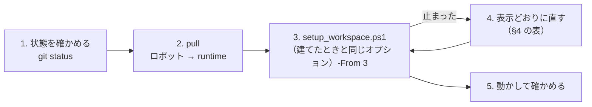

# 既にある環境を新しくする — Windows

[START_HERE.md](START_HERE.md) で建てた Windows の作業場所を、GitHub の最新に合わせるときの入口です。
新しく建てるときと同じ **`tools\windows\setup_workspace.ps1`** を使います。スクリプトは「できているものは飛ばす」ので、
更新では **pull してから同じコマンドを `-From 3` で流す**だけです。箱庭コアや SDK を作り直す必要があるときは、スクリプトが止まって教えます。

> **Linux（Ubuntu 24.04）の作業場所を新しくするとき**は [UPDATE_HERE_linux.md](UPDATE_HERE_linux.md)。



## 1. 何が変わると、何が起きるか

更新のたびに「何が変わったか」を調べる必要はありません。§3 の手順を流せば、スクリプトが判断します。目安として:

| 変わったもの | 起きること | 時間 |
|---|---|---|
| ロボットのリポジトリ（humanoid・cobot・armpi）のコード・文書 | W6 でビルドし直す | 各 数分 |
| runtime（ロボットの `deps.lock` が上がる） | W3 で版を照合 → W6 でビルドし直す | 各 数分 |
| sensor の版（`deps.lock`） | W3 で止まる → 表示のコマンドで合わせる（§4） | 1 分 |
| **箱庭コア**（runtime の `tools\hako_core\third_party.lock`） | W4 で止まる → `third_party` を取り直し、W5 で **SDK を作り直す**（§4） | **約 1〜1.5 時間** |
| MuJoCo・vcpkg の版（SDK の材料） | W5 で止まる → SDK を作り直す（§4） | 約 1〜1.5 時間 |

## 2. 始める前に

- **建てたときと同じオプション**を使います。とくに `-Robot`・`-Robo`（SDK の場所）・`-Godot`・`-WithNcMachine`。
  環境変数 `DEVAI_ROBO`・`GODOT_EXE` を `setx` で登録してあれば、`-Robo`・`-Godot` は省けます。
- Godot・箱庭のデモ・ビルドの窓を閉じます（使用中のファイルがあると、ビルドや SDK の退避が止まります）。
- SDK を作り直すことになったときは、**作業場所を VS Code で開いていない**こと（フォルダの名前の変更が拒否されます。[START_HERE.md](START_HERE.md) §7）。
- `third_party\` の下は他者のリポジトリです。pull・checkout・編集はしません（取り直しはスクリプトがします）。

## 3. 手順（ロボットの作業場所）

例は作業場所 `D:\work_build`。自分の作業場所に読み替えます。

### 3.1 状態を確かめる

```powershell
cd D:\work_build
foreach ($r in "hakoniwa-humanoid","hakoniwa-armpi","hakoniwa-cobot","hakoniwa-godot-robot","hakoniwa-mujoco-runtime") {
    if (Test-Path "$r\.git") { Write-Host "== $r"; git -C $r status --short --branch }
}
```

- 1 行目が `## main...origin/main` なら、そのまま pull できます。
- 変更の行（` M …`）が出たら、その変更を残すか決めます。要らなければ `git -C <リポジトリ> restore .`、残すならコミットするか `git -C <リポジトリ> stash`。
  `config.local.ps1`（humanoid の設定）は git に入っていないので、出ませんし、pull でも消えません。
- runtime が `## HEAD (no branch)` なら、前に `deps.lock` の版へ checkout したままです。§3.2 の `switch main` で main に戻ります。

### 3.2 pull する

**ロボットのリポジトリを先に、runtime を後に**します（ロボットの `deps.lock` が runtime のどの版を使うかを決めているため）。
建てていないロボットのリポジトリは飛ばします（無ければ下のループが飛ばします）。

```powershell
cd D:\work_build
foreach ($r in "hakoniwa-humanoid","hakoniwa-armpi","hakoniwa-cobot","hakoniwa-godot-robot","hakoniwa-ncmachine","image2sim-framework") {
    if (Test-Path "$r\.git") { Write-Host "== $r"; git -C $r pull --ff-only }
}
git -C hakoniwa-mujoco-runtime switch main
git -C hakoniwa-mujoco-runtime pull --ff-only
```

- `--ff-only` は、手元に別のコミットがあるときに勝手にマージせず止めるためです。止まったら §4。
- **hakoniwa-mujoco-sensor は pull しません**。版は `deps.lock` が決め、W3 が照合します（違えば §4）。
- hakoniwa-godot-robot は humanoid のデモのコード（非公開）。hakoniwa-ncmachine・image2sim-framework は cobot を `-WithNcMachine` で建てたときだけあります。

### 3.3 setup_workspace を流す

建てたときと同じオプションに `-From 3` を付けます（W1 のツール・W2 の clone は済んでいるので飛ばす）。

```powershell
cd D:\work_build
powershell -ExecutionPolicy Bypass -File hakoniwa-mujoco-runtime\tools\windows\setup_workspace.ps1 -Robot humanoid,cobot,armpi -From 3
# 例: SDK・Godot が既定の場所でないとき（環境変数で登録していなければ）
powershell -ExecutionPolicy Bypass -File hakoniwa-mujoco-runtime\tools\windows\setup_workspace.ps1 -Robot humanoid,cobot,armpi -Robo C:\work_cobot\devai_robo -Godot "C:\…\Godot_v4.7.1-stable_win64.exe" -From 3
```

| 段 | 更新のときにすること |
|---|---|
| W3 | 各ロボットの `deps.lock` と runtime・sensor の版を照合（違えば止まる） |
| W4 | `third_party` の版を runtime の `third_party.lock` と照合（違えば止まる） |
| W5 | SDK を確かめる。そろっていて版も同じなら**何もしない**（数秒）。違えば止まる |
| W6 | ロボットごとの準備をやり直す（venv・ビルド・Godot addon。humanoid の `config.local.ps1` はあれば触らない） |
| W7 | 確認と「次に動かすコマンド」 |

最後に `[setup_workspace] できました` が出れば終わりです。

先に何が起きるかだけ見たいときは、`-From 3` の代わりに `-Check` を付けます（何も作らず W3・W4・W7 の照合だけ）。

### 3.4 動かして確かめる

[START_HERE.md](START_HERE.md) §4 の表のとおり（W7 の最後にも出ます）。たとえば:

```powershell
powershell -ExecutionPolicy Bypass -File hakoniwa-humanoid\scripts\windows\verify.ps1 -Check viewer   # humanoid のビューア（約 1 分）
powershell -ExecutionPolicy Bypass -File hakoniwa-cobot\scripts\windows\demo.ps1                       # cobot を Godot で（約 1 分）
powershell -ExecutionPolicy Bypass -File hakoniwa-armpi\scripts\windows\run_demo.ps1 -Demo motion     # armpi
```

## 4. 止まったとき

| 症状 | 対処 |
|---|---|
| pull が `Not possible to fast-forward` | 手元にコミットがある。要らなければ `git -C <リポジトリ> reset --hard origin/main`（**手元のコミットは消える**）。残すなら `git -C <リポジトリ> pull --rebase` |
| pull が `Your local changes … would be overwritten` | §3.1 の変更が残っている。`restore`・`stash`・コミットのどれかをしてから pull |
| W3 で `hakoniwa-mujoco-runtime のコミットが deps.lock と違う` | runtime の main が、ロボットの `deps.lock` より新しい（ロボット側の lock がまだ上がっていない）。表示の「lock の版にする」のコマンドを流して `-From 3`。runtime は main から外れた状態になるので、次の更新では §3.2 の `switch main` で戻る |
| W3 で `hakoniwa-mujoco-sensor のコミットが deps.lock と違う` | sensor の版が上がった。表示の「lock の版にする」のコマンド（`fetch --depth 1 …` と `checkout --detach …`）を流して `-From 3` |
| W3 で `runtime の hakoniwa-godot が runtime の記録と違う` | runtime の中の hakoniwa-godot（サブモジュール）が、pull した runtime の記録より古い。`git -C hakoniwa-mujoco-runtime submodule update --init --recursive third_party/hakoniwa-godot` で記録の版にして `-From 3` |
| W4 で `third_party の版が lock と違う` | 箱庭コアが上がった。下の「箱庭コアが上がったとき」 |
| W5 で `SDK が lock と違うか、足りません` | SDK を作り直す。下の「箱庭コアが上がったとき」の 2 から |
| W6 のビルドで止まった | 表示のログを見る。Godot・デモの窓を閉じてから `-From 6` |
| ほかは | [START_HERE.md](START_HERE.md) §7 |

### 箱庭コアが上がったとき（約 1〜1.5 時間）

1. `third_party` を取り直す（今のものは `third_party.old-<日時>` に退避。中身は触らない）

   ```powershell
   python hakoniwa-mujoco-runtime\tools\hako_core\fetch_third_party.py --refresh
   ```

2. SDK を作り直して、ロボットもビルドし直す（今の SDK は `devai_robo.old-<日時>` に退避）

   ```powershell
   powershell -ExecutionPolicy Bypass -File hakoniwa-mujoco-runtime\tools\windows\setup_workspace.ps1 -Robot humanoid,cobot,armpi -From 4 -RebuildSdk
   ```

   途中で止まったら、原因を直して `-From 5 -SdkFrom <止まった S の番号> -RebuildSdk`（作りかけは退避せずに続きから作る）。

3. §3.4 で確かめる。退避した `third_party.old-*`・`devai_robo.old-*` は、新しいもので動くのを確かめてから消します
   （戻すときは、新しいほうを別名にして、退避したものの名前を戻し、`-From 6` でロボットをビルドし直す）。

## 5. ドローンの作業場所

ドローンは別の作業場所（例 `D:\work_drone\work_git`）です。流れは同じで、pull するリポジトリとオプションが違います。

> 下の手順を 1 本で行うスクリプトもあります: `pwsh hakoniwa-mujoco-drone\tools\local_sdk\update_workspace.ps1`（pull → runtime・sensor を `deps.lock` の版に → 箱庭コアが違えば取り直し・SDK だけ作り直し → ビルド → hakodrone。`--check` で見るだけ。drone の [docs/manual/13_update.md](../../hakoniwa-mujoco-drone/docs/manual/13_update.md)）。

```powershell
cd D:\work_drone\work_git
foreach ($r in "hakoniwa-mujoco-drone","hakoniwa-drone-companion") { git -C $r pull --ff-only }
git -C hakoniwa-mujoco-runtime switch main
git -C hakoniwa-mujoco-runtime pull --ff-only
powershell -ExecutionPolicy Bypass -File hakoniwa-mujoco-runtime\tools\windows\setup_workspace.ps1 -Drone -From 3          # -Test で ctest も（約 25 分）
```

- ドローンの W5（drone の `tools\local_sdk\setup_windows.ps1`）は、SDK・MuJoCo・venv があれば飛ばし（SDK の箱庭コアが lock と違えば止まる）、
  drone・companion のビルドをやり直します。
- 箱庭コアが上がったときは、`fetch_third_party.py --refresh` のあと `-Drone -From 4 -RebuildSdk`（SDK・MuJoCo・venv を作り直す）。
- W3 で runtime が `deps.lock` と違うと出たら、ロボットと同じく表示の「lock の版にする」を流して `-From 3`（drone・companion の `deps.lock` が runtime の main より古いとき）。
- companion の `deps.lock` は drone の版も決めています。W3 で drone が違うと出たら、drone を pull し忘れていないか、表示の「lock の版にする」を見ます。

## 6. 関連

| 知りたいこと | 文書 |
|---|---|
| 新しく建てる・各段とオプションの意味・動かし方 | [START_HERE.md](START_HERE.md) |
| 箱庭コアを上流の最新に上げる（上げる側の手順） | [hako_core_update.md](hako_core_update.md) |
| ロボット共通 SDK の中身・段（S0〜S5） | [windows_robot_setup.md](windows_robot_setup.md) |
