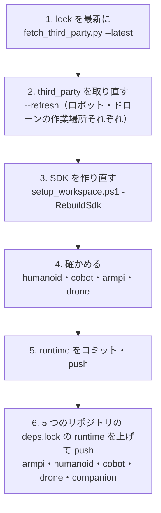

# 箱庭コアを上流の最新に上げる（ロボット・ドローン共通）

**方針（2026-11-10 決定）**: 箱庭コアは、ロボット（armpi・humanoid・cobot）もドローン（drone・companion）も、**いつも上流の最新の同じ版**を使う。
版を書いておく場所は 1 つだけです: **`tools\hako_core\third_party.lock`**。

| 中身 | 上流 |
|---|---|
| hakoniwa-core-pro | https://github.com/hakoniwalab/hakoniwa-core-pro（main） |
| hakoniwa-core-cpp・hakoniwa-pdu-registry | core-pro のサブモジュール（core-pro が記録しているコミット） |
| hakoniwa-pdu-endpoint | https://github.com/hakoniwalab/hakoniwa-pdu-endpoint（main） |

Godot の GDExtension（hakoniwa-godot）は、runtime の `third_party\hakoniwa-godot` のコードを使い、その中の core-pro・pdu-endpoint を
この lock の版に差し替えて作ります（SDK と共有メモリの形をそろえるため。`robo_sdk\build_godot_ext.ps1`）。

## 流れ



### 1. lock を最新に

```powershell
cd D:\work_build
python hakoniwa-mujoco-runtime\tools\hako_core\fetch_third_party.py --latest --dry-run   # 何が変わるかだけ
python hakoniwa-mujoco-runtime\tools\hako_core\fetch_third_party.py --latest             # lock を書き換える
```

### 2. third_party を取り直す

```powershell
python hakoniwa-mujoco-runtime\tools\hako_core\fetch_third_party.py --refresh
```

今の `third_party` は `third_party.old-<日時>` に名前を変えて残します（中身は触りません。要らなくなったら消す）。

### 3. SDK を作り直す（ロボットは約 1 時間・ドローンは約 10 分）

```powershell
powershell -ExecutionPolicy Bypass -File hakoniwa-mujoco-runtime\tools\windows\setup_workspace.ps1 -Robot humanoid,cobot,armpi -RebuildSdk
# ドローンの作業場所では
powershell -ExecutionPolicy Bypass -File hakoniwa-mujoco-runtime\tools\windows\setup_workspace.ps1 -Drone -RebuildSdk -Test
```

- ロボットの今の SDK は `devai_robo.old-<日時>` に退避されます。戻すときは、新しい `devai_robo` を別名にして、退避したものの名前を戻します
  （ロボットのビルド木・venv も作り直すこと。W6 をやり直せばよい）。
- Boost・GLFW は vcpkg のバイナリキャッシュ（`%LOCALAPPDATA%\vcpkg\archives`）から戻るので、2 回目からは速くなります。

### 4. 確かめる

| 対象 | コマンド | 合格 |
|---|---|---|
| SDK | `robo_sdk\check_robo_sdk.ps1` | 全部 `[ok]`（箱庭コアの版 = lock を含む） |
| humanoid | `factory_demo\hako\check_hako.ps1 -Scenario rezot`、`start_hako.bat` | 4/4 台・実時間比 約 1.0・Godot で操作できる |
| cobot | `scripts\windows\verify_all.ps1` | 全部 合格 |
| armpi | `scripts\windows\run_demo.ps1 -Demo motion` | Godot に表示・`run.json` に接触の回数 |
| drone | `setup_workspace.ps1 -Drone -Test` | ctest drone 96・companion 32 |

### 5・6. コミットと deps.lock

runtime の lock の変更をコミット・push し、その runtime のコミットを 5 つのリポジトリの `deps.lock` に書いて push します
（`hakoniwa-mujoco-runtime   https://…   <新しいコミット>` の行。companion は drone の行も）。

★ 展示会などの前は上げない（動いている版を変えない）。上げるのは、確かめる時間があるとき。

## 版の履歴

| 日付 | core-pro | core-cpp | pdu-registry | pdu-endpoint | メモ |
|---|---|---|---|---|---|
| 〜2026-11-09 | ロボット efc9d0c（v1.2.0）／ドローン e56655e（v1.3.0） | | | ロボット 66bdfb8／ドローン 12230c9 | ばらばらだった |
| 2026-11-10 | 722ce02 | 3def26c | c40ad51 | 3b7b25a | 共通化（上流の main の先頭）。2026-11-11 ロボットで確認：humanoid check_hako rezot 4/4・実時間比 1.001、Godot ライブ表示、cobot verify_all 7/7 合格、armpi 4 デモ＋Godot。GDExtension は hakoniwa-godot 8f5d7d1 のままビルドできた（pdu-endpoint のベンチマーク・ツールを切る `-D` だけ足した） |
