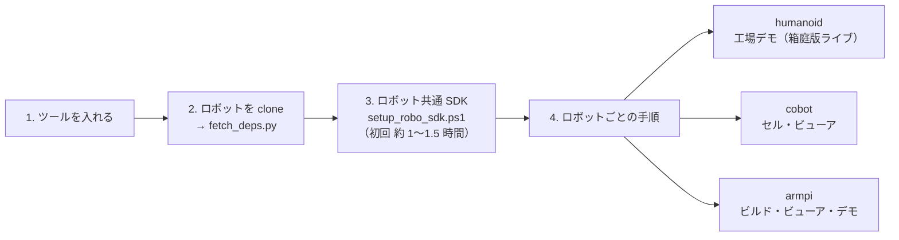

# Windows でロボットを建てる共通手順（armpi・humanoid・cobot）

Windows 11 の新しい PC で、hakoniwa-armpi・hakoniwa-humanoid・hakoniwa-cobot の**どれから始めても同じ手順**で、
ロボット共通 SDK を作ってビルド〜動作確認まで進めるための手順書です。WSL は使いません。



SDK は 1 台の PC に 1 つあれば、3 つのロボットで共用できます（2 台目のロボットでは 3 を飛ばします）。

## 1. ツール

| ツール | 版 | メモ |
|---|---|---|
| Windows 11 | 64 bit | |
| Visual Studio 2022 | Community・Professional・Enterprise のどれか | 「**C++ によるデスクトップ開発**」を入れる。場所はスクリプトが `vswhere` で探す |
| CMake | 3.21 以上 | PATH に置く（`cmake --version` が動くこと） |
| Git | 2.x | PATH に置く。長いパスを使うので `git config --global core.longpaths true` |
| Python | **3.12（64 ビット）** | python.org 版を `%LOCALAPPDATA%\Programs\Python\Python312` に入れる。`python3`（ストアのエイリアス）は使わない。箱庭の `hakopy.pyd` は 3.12 専用 |
| Godot | **4.7.1（mono 版）** | ビューアを使うとき。例 `D:\Godot_v4.7.1-stable_mono_win64\`（同じフォルダの `_console.exe` も使う） |
| ディスク | 約 5 GB | SDK（vcpkg・ビルド木を含む）約 3.5 GB ＋ リポジトリ |

- 社内ネットワークでプロキシが要るときは、`HTTP_PROXY`・`HTTPS_PROXY` を設定してから始めます。
  vcpkg のダウンロードが失敗するときは `$env:X_VCPKG_ASSET_SOURCES = 'x-script,C:\Windows\System32\curl.exe -sSL --fail --retry 3 -o {dst} {url}'` も設定します。
- パスが長くなるので、作業場所は浅いところ（例 `D:\work_build`）にします。

## 2. ロボットを clone して依存を用意する

作業場所（例 `D:\work_build`）の下に、ロボットと依存を**兄弟フォルダ**として並べます。サブモジュールは使いません。

```powershell
cd D:\work_build
git clone https://github.com/hako-community/hakoniwa-humanoid.git     # ← 始めるロボット（armpi・cobot でも同じ）
python hakoniwa-humanoid\tools\fetch_deps.py
```

`fetch_deps.py` は、ロボットの `deps.lock` の版で次を用意します（既にあれば版を確かめるだけで、書き換えません）。

```text
D:\work_build\
├─ hakoniwa-humanoid\            ← ロボット（deps.lock・tools\fetch_deps.py）
├─ hakoniwa-mujoco-runtime\      ← このリポジトリ。ロボット共通 SDK のスクリプト（tools\windows\robo_sdk\）
│   ├─ third_party\hakoniwa-godot\     ← 他者のリポジトリ（読むだけ）。hakoniwa-core-pro・pdu-endpoint・godot-cpp を含む
│   └─ external_library\nlohmann-json\ ← v3.12.0 を同梱
├─ hakoniwa-mujoco-sensor\       ← センサ
└─ devai_robo\                   ← 3 で作るロボット共通 SDK（git 管理外）
```

- 版が `deps.lock` と違うと CMake が止まります（試すときだけ `-DHAKO_DEPS_ALLOW_MISMATCH=ON`）。
- ★ `third_party\` の下は他者のリポジトリです。編集・ビルド・checkout はしません。SDK のスクリプトも `git archive` で外に写してから作ります。

ロボットごとに、ほかにも要るリポジトリがあります。

| ロボット | 一緒に clone するもの |
|---|---|
| humanoid（工場デモ） | `hakoniwa-armpi`（ライン2 のアームのモデル）・`hakoniwa-godot-robot`（**非公開**。デモのコード。hako-community の権限が要る） |
| cobot | なし（加工機と連携するときだけ `hakoniwa-ncmachine`） |
| armpi | なし |

## 3. ロボット共通 SDK を作る（初回だけ。約 1〜1.5 時間）

```powershell
cd D:\work_build
powershell -ExecutionPolicy Bypass -File hakoniwa-mujoco-runtime\tools\windows\robo_sdk\setup_robo_sdk.ps1
```

| オプション | 既定 | 意味 |
|---|---|---|
| `-Robo` | 環境変数 `DEVAI_ROBO`、無ければ `<作業場所>\devai_robo` | SDK を作る場所 |
| `-From N` | 1 | 手順 S-N から再開する |
| `-MmapDir` | `Z:` があれば `Z:/mmap_robo`、無ければ `C:/hako_mmap_robo` | 共有メモリの場所（ほかの箱庭の作業と分ける） |
| `-Python` | `%LOCALAPPDATA%\Programs\Python\Python312\python.exe` | Python 3.12 |
| `-VsDevCmd` | `vswhere` で探す | Visual Studio 2022 の `VsDevCmd.bat` |

| 段 | スクリプト | 作るもの | 所要 |
|---|---|---|---|
| S1 | `build_sdk.ps1` | 箱庭コア（`hako-cmd.exe`・`hakopy.pyd`）・pdu-endpoint・vcpkg（Boost・GLFW）・MuJoCo 3.9.0（`external_library\mujoco.lock` の SHA256 で照合） | 約 1 時間 |
| S2 | `init_runtime.ps1` | 共有メモリの設定 `runtime\windows-msvc-x64\cpp_core_config.json` | 数秒 |
| S3 | `build_master.ps1` | 壁時計に合わせて進めるマスタ `hako-realtime-master.exe`（ソースは `tools\windows\realtime_master`） | 約 1 分 |
| S4 | `build_endpoint_ffi.ps1` | pdu-endpoint の C 呼び出し部品 `_c_endpoint_ffi.cp312-win_amd64.pyd`（中継アセットが使う。静的リンクなので DLL は要らない） | 約 1 分 |
| S5 | `build_godot_ext.ps1` | hakoniwa-godot の GDExtension と型変換（`hako_msgs`・`std_msgs`・`geometry_msgs`・`sensor_msgs`）→ `godot-addon\` | 約 20〜30 分 |

最後に `check_robo_sdk.ps1` が、ファイルの有無と import を確かめます（単独でも実行できます。何も書き換えません）。

```powershell
powershell -ExecutionPolicy Bypass -File hakoniwa-mujoco-runtime\tools\windows\robo_sdk\check_robo_sdk.ps1
```

できあがり:

```text
devai_robo\
├─ sdk\windows-msvc-x64\
│   ├─ sdk\hakoniwa-core\          箱庭コア（bin・lib・include・python）。python に hakopy・hakoniwa_pdu・hakoniwa_pdu_endpoint
│   ├─ sdk\hakoniwa-pdu-endpoint\  pdu-endpoint（静的ライブラリ・ヘッダ）
│   ├─ vcpkg\                      Boost・GLFW
│   ├─ mujoco-3.9.0\               MuJoCo（公式版）
│   ├─ master\bin\                 hako-realtime-master.exe
│   └─ godot-addon\addons\         hakoniwa・hakoniwa_msgs（godot_addon_manifest.json に元のコミットと SHA-256）
├─ runtime\windows-msvc-x64\cpp_core_config.json
└─ src\・build\                    書き出したコピーとビルド木（消しても動作には影響しない）
```

### SDK を使うシェル

```powershell
. D:\work_build\hakoniwa-mujoco-runtime\tools\windows\robo_sdk\env_robo.ps1
hako-cmd.exe --help
```

このプロセスだけ `HAKO_CONFIG_PATH`・`PYTHONPATH`・`PATH` などを SDK に向けます。ユーザ環境変数に古い箱庭 SDK（`hakoCore-win`・`hakoApps-win`）が残っていても、そちらは読みません。

### 動かす側の Python

SDK の Python パッケージは、各ロボットの venv に `.pth` で足して使います。C 呼び出し部品は動かすときにも cffi が要るので、
venv には **cffi 2.1.1**（SDK を作った版と同じ）を入れます（各ロボットの `make_venv.ps1` が入れます）。

## 4. ロボットごとの手順

| ロボット | 手順書 | 流れ |
|---|---|---|
| humanoid | `hakoniwa-humanoid\docs\windows_factory_demo\README.md`（02 → 05 → 06） | `config.local.ps1` → `setup_hako.ps1 -From 2`（SDK は 3 で作ったものを使う）→ `check_hako.ps1` → `start_hako.bat` |
| cobot | `hakoniwa-cobot\docs\windows_setup.md` | `make_venv.ps1` → `build.ps1` → `stage_godot_addon.ps1` → `verify_all.ps1` |
| armpi | `hakoniwa-armpi\docs\windows_setup.md`（作成中） | |

SDK の場所が既定（`<作業場所>\devai_robo`）と違うときは、各ロボットのスクリプトの `-Robo`（humanoid は `config.local.ps1` の `$RoboRoot`）で渡します。

## 5. 困ったとき

| 症状 | 原因 | 対処 |
|---|---|---|
| `SDK は既にあります` で止まる | S1 は上書きしない | そのまま使うなら `-From 2`。作り直すなら `devai_robo\sdk` を退避してから |
| `Visual Studio 2022 の VsDevCmd.bat が見つかりません` | 「C++ によるデスクトップ開発」が入っていない | Visual Studio Installer で入れる。別の場所なら `-VsDevCmd` |
| `hakoniwa-godot … が見つかりません` | `fetch_deps.py` をしていない | ロボットのリポジトリで `python tools\fetch_deps.py` |
| S1 で vcpkg のダウンロードが失敗する | プロキシ | 1 の `X_VCPKG_ASSET_SOURCES` を設定して `-From 1`（出力先を消してから） |
| `Filename too long` | Windows のパスの長さ | `git config --global core.longpaths true`。作業場所を浅くする |
| `import hakopy` で古い SDK を読む | ユーザ環境変数に古い箱庭 SDK | `env_robo.ps1` で読み込む（各ロボットのスクリプトは自動で外す） |
| `ModuleNotFoundError: _c_endpoint_ffi` / `_cffi_backend` | S4 をしていない / venv に cffi が無い | `setup_robo_sdk.ps1 -From 4` / venv に `cffi==2.1.1` |
| Godot で型変換（codec）のエラー | 作っていない型を manifest が並べている | ロボットの addon を置くスクリプトをやり直す（作った型だけに絞る） |
